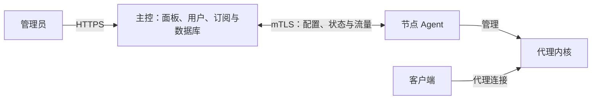

<p align="center">
  
</p>

<h1 align="center">Polaris</h1>

<p align="center">多内核代理管理面板 · 一个主控，统一管理多台节点</p>

<p align="center">
  <a href="https://github.com/cuijianzhuang/Polaris/actions/workflows/ci.yml"></a>
  <a href="https://github.com/cuijianzhuang/Polaris/actions/workflows/release.yml"></a>
  <a href="https://github.com/cuijianzhuang/Polaris/releases/latest"></a>
  
  <a href="LICENSE"></a>
  <br>
  <a href="https://github.com/cuijianzhuang/Polaris/stargazers"></a>
  <a href="https://github.com/cuijianzhuang/Polaris/network/members"></a>
  <a href="https://github.com/cuijianzhuang/Polaris/commits/main"></a>
  <a href="https://github.com/cuijianzhuang/Polaris/issues"></a>
</p>

<p align="center">
  <a href="#快速开始">快速开始</a> ·
  <a href="docs/user-guide.md">用户使用手册</a> ·
  <a href="https://github.com/cuijianzhuang/Polaris/releases">版本下载</a> ·
  <a href="#开发">开发指南</a> ·
  <a href="https://github.com/cuijianzhuang/Polaris/issues">问题反馈</a>
</p>

Polaris 将节点、入站、用户和订阅集中在一个面板中管理。每台节点运行 Agent，由它安装和管理 **Xray-core、sing-box、mihomo、Hysteria2 官方服务端**等内核；同一套用户和授权配置可以应用到不同节点与内核。

适合需要管理多台服务器、多种协议，以及统一分配用户流量、有效期和订阅的管理员。后台支持中文 / English、明暗主题和移动端布局。

## 核心功能

| 场景 | 能力 |
| --- | --- |
| 节点与内核 | 一次性令牌接入、节点状态与资源监控、多内核共存、Agent 升级、内核版本切换与失败回退 |
| 协议与入站 | VLESS、VMess、Trojan、Shadowsocks 2022、Hysteria2、TUIC、AnyTLS 等；支持 REALITY、Vision、XHTTP、WS、gRPC 等组合，按内核版本校验兼容性 |
| 用户与套餐 | 流量配额、固定 / 首次使用后到期、周期重置、自动续订、分组和等级授权、节点流量包、IP / HWID 限制、批量操作 |
| 订阅分发 | 通用链接、Clash / mihomo、sing-box、Surge、Loon、Quantumult X；订阅信息页、二维码、客户端导入、独立订阅域名 |
| 路由与中转 | 入站模板、出站与负载均衡、全局 / 节点路由、realm / GOST 端口转发、链式代理、CDN 入口与 Caddy 回源 |
| 节点地图 | 世界地图展示所有节点的位置与在线状态，纯内置矢量图，无需外部地图服务，离线可用 |
| 日常运维 | 流量统计、节点和入站探测、Telegram 告警、本地定时备份与恢复、审计日志、服务器成本管理 |
| 账号与安全 | 主控与 Agent 使用 mTLS；敏感字段加密；自定义后台路径、两步验证、GitHub / Telegram / OIDC / OAuth2 登录 |
| 专业版扩展 | 客户独立限速、订阅转换、DDNS 与域名绑定、Telegram 管理菜单、备份推送、自定义 Logo、黑金专属主题 |

协议、传输和客户端并非任意组合。请以界面的能力提示为准，常见限制见[使用手册 · 兼容性](docs/user-guide.md#compatibility)。

## 工作方式



代理流量由客户端直接连接节点，不经过主控。主控暂时离线时，节点按最后一次成功应用的配置继续运行，流量记录在本地，恢复连接后补报。配置变更会经过渲染、内核校验和应用，失败时回滚。

主控默认使用 SQLite，可选 PostgreSQL；Redis 用于可选的流量计数缓冲，基础部署无需单独安装数据库服务。

## 版本与许可证

本仓库社区代码采用 [GNU Affero General Public License v3.0](LICENSE)（SPDX：`AGPL-3.0-only`）。允许商业使用；分发软件或通过网络提供修改版服务时，需要履行该协议规定的对应源码提供、版权声明等义务。

未包含在本仓库中的 `polaris-pro` 等私有代码，其许可条款由相应权利人另行提供；面板激活码不替代开源协议义务。如需在 AGPL 条款之外使用或分发相关代码，应另行取得相应权利人的授权。第三方依赖和独立内核仍遵循各自许可证。

Copyright © 2026 Polaris contributors.

| 项目 | 社区版 | 专业版 |
| --- | --- | --- |
| 面板、节点、用户、订阅、多内核等基础功能 | 支持 | 支持 |
| 客户独立限速、订阅转换、DDNS 与域名绑定 | — | 需要相应许可证授权 |
| Telegram 管理菜单、备份推送到 Telegram / WebDAV / S3 | — | 需要相应许可证授权 |
| 自定义 Logo、黑金专属主题 | — | 激活许可证后在「设置 → 外观」配置 |
| 源码 | 本仓库 | 本仓库 + 私有 `polaris-pro` 代码 |
| Docker 镜像 | `ghcr.io/cuijianzhuang/polaris:latest` | `ghcr.io/cuijianzhuang/polaris:latest-pro` |

两种版本的数据和配置通用。一键安装可用 `--community` 或 `--pro` 指定版本，安装后用 `polaris switch community` / `polaris switch pro` 切换。**启用专业版功能需要专业版程序及有效授权，仅向社区版导入许可证不会补齐专业版代码。**

专业版在「许可证」页面联网激活或导入离线许可证。套餐、功能、数量上限、到期日和更新期限以该页面为准，详见[许可证管理](docs/user-guide.md#license)。

## 快速开始

### 1. 安装主控

准备一台支持 **systemd 的 Linux 服务器（amd64 / arm64）**，以 root 执行。将示例域名替换成自己的域名，并先解析到主控服务器：

```bash
bash <(curl -fsSL https://raw.githubusercontent.com/cuijianzhuang/Polaris/main/scripts/install-panel.sh) install --community --domain panel.example.com
```

脚本会下载并校验发布文件，安装主控与 Caddy，生成密钥和后台路径，并输出后台地址及初始登录信息。安装专业版时将 `--community` 改为 `--pro`。

- 主控放行 `80/tcp`、`443/tcp`，以及 Agent 接入端口 `9443/tcp`；云服务器安全组也需要放行。
- `9443` 使用独立的 mTLS，应让 Agent 直连，不能经过普通 HTTP 反向代理或 CDN。
- 保存安装结果中的后台地址。访问站点根路径可能返回 404，这是自定义后台路径的预期行为。
- 没有域名时可去掉 `--domain panel.example.com`，使用 IP + HTTP 做临时测试。

使用 Docker 或自备反向代理，见[手册 · 安装与部署](docs/user-guide.md#installation)。

### 2. 接入节点

登录后台，进入「节点 → 节点列表」，点击「添加节点」，填写名称、地址并选择内核。创建后，将面板生成的安装命令复制到节点服务器，以 root 执行，等待显示在线。

主控服务器也可以同时作为节点：在主控上运行 `polaris node`。节点主动连接主控，无需额外开放 Agent 管理端口；客户端使用的代理端口仍需单独放行。

### 3. 创建入站并授权用户

1. 在「入站与转发 → 入站」创建入站，或通过「入站模板」预览并批量生成。
2. 确认内核运行正常、配置下发成功，并放行入站所需的 TCP / UDP 端口。
3. 在「用户」创建用户，设置配额和有效期，授权整台节点、分组或指定入站。
4. 复制该用户的订阅链接，导入兼容的客户端并测试连接。

完整步骤及检查方法见[手册 · 首次配置](docs/user-guide.md#first-connection)。普通订阅用户可直接阅读[客户端使用](docs/user-guide.md#client-use)。

## 常用运维命令

以下命令用于一键安装的主控服务器；执行 `polaris` 可打开交互式菜单。

| 命令 | 用途 |
| --- | --- |
| `polaris info` | 查看后台地址、端口与服务信息 |
| `polaris status` / `polaris log` | 查看运行状态 / 日志 |
| `polaris doctor` | 检查服务、端口、防火墙、DNS、HTTPS、时钟和磁盘 |
| `polaris check-update` / `polaris update` | 检查版本 / 升级主控 |
| `polaris backup` | 创建备份，可交互输入加密口令 |
| `polaris reset-password` | 重置管理员密码、解除账号锁定并注销会话 |
| `polaris help` | 查看全部命令 |

升级、恢复和迁移的操作顺序见[手册 · 维护与备份](docs/user-guide.md#maintenance)。

## 开发

需要 **Go 1.25 或更新的兼容版本、Node.js 与 npm**；前端 CI 使用 Node.js 22。前端构建产物会嵌入主控二进制，修改前端后需重新构建主控。

```bash
git clone https://github.com/cuijianzhuang/Polaris.git
cd Polaris
make web build       # 安装锁定的前端依赖，构建前端、主控和 Agent
make test            # go vet + Go 测试
```

启动主控需要配置密钥、数据目录和监听地址，见[手册 · 配置项](docs/user-guide.md#configuration)。前端开发服务器通过以下命令启动；需要同时运行后端，并使用根后台路径 `/`，让默认的 `/api` 代理匹配后端路由：

```bash
cd web
npm run dev
```

更多检查：

```bash
cd web
npm run i18n:check
npm run build
cd ..
make test-cores XRAY=/path/to/xray SINGBOX=/path/to/sing-box
```

真实内核测试需要对应二进制；mihomo、GOST、ACME 与防火墙等检查还有额外前置条件，参见 [CI 配置](.github/workflows/ci.yml)。未提供依赖时，相关测试可能跳过。

有私有 `polaris-pro` 仓库访问权限时，将其放在本仓库旁边：

```bash
scripts/pro.sh link ../polaris-pro
go build -tags pro ./...
go vet -tags pro ./...
go test -tags pro ./internal/panel/ ./internal/agent/ ./internal/license/
# 开发结束后可移除链接；不加 pro 标签始终构建社区版
scripts/pro.sh clean
```

链接后的专业版文件属于同一个 Go 包，修改链接文件会直接改动 `polaris-pro` 仓库。

| 目录 | 内容 |
| --- | --- |
| `cmd/panel`、`cmd/agent` | 主控与 Agent 入口 |
| `api/proto` | 主控与 Agent 的通信定义，使用 `buf generate` 生成代码 |
| `internal/core` | 内核适配器与能力矩阵 |
| `internal/panel`、`internal/agent` | API、调度、配置同步与节点执行逻辑 |
| `internal/store`、`internal/model` | 数据存储与统一模型 |
| `internal/sub`、`internal/license` | 订阅处理与许可证校验 |
| `web` | React + TypeScript + Vite 后台 |

登录后的 API 文档位于 `<后台路径>/api/v1/openapi.json`，实时节点数据通过 `<后台路径>/api/v1/ws` 提供。外部服务对接见 [API 令牌与订单接口](docs/plugins/api-tokens.md)。设计资料见[客户独立限速](docs/design/per-user-speed-limit.md)、[许可证机制](docs/design/licensing.md)和[插件系统设计提案](docs/design/plugins.md)。插件开发见 [polaris-plugins](https://github.com/cuijianzhuang/polaris-plugins)，管理入口在「扩展 → 插件」，使用说明见[用户手册](docs/user-guide.md#plugins)。

## 安全部署与问题反馈

- 使用 HTTPS，保存并备份 `POLARIS_SECRET_KEY`；丢失后无法解密已有敏感数据。
- 设置自定义后台路径、强密码和两步验证；反向代理只信任实际使用的代理地址。
- 将订阅链接视为访问凭据。重置订阅同时更换用户 UUID 和密码，用户需要重新导入。
- 管理员拥有高权限，配置模板、Webhook 和远程规则来源应由可信人员维护。
- 管理会话令牌保存在浏览器 localStorage 中；使用可信浏览器环境。账号登录失败锁定也可能被知道用户名的人触发。

遇到问题先查看[故障排查](docs/user-guide.md#troubleshooting)，再提交 [Issue](https://github.com/cuijianzhuang/Polaris/issues)。请提供版本、安装方式、相关内核与客户端版本、复现步骤及脱敏日志；不要提交订阅令牌、私钥、密码或完整备份。
