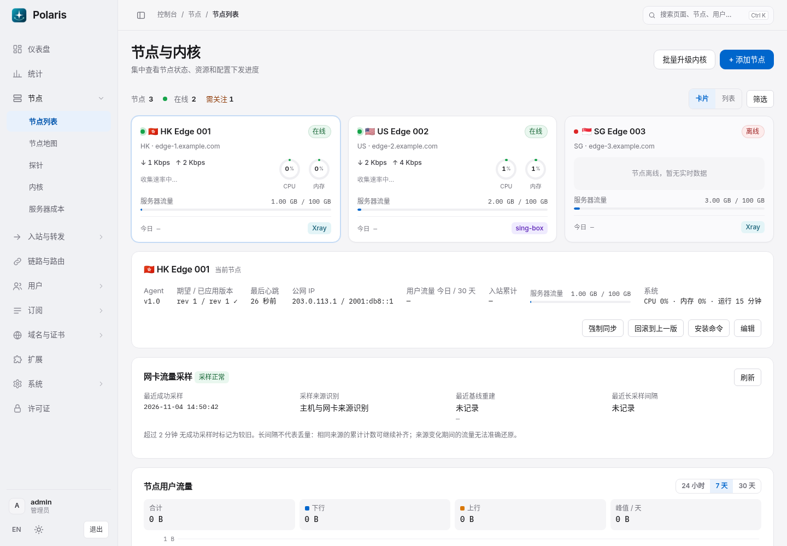
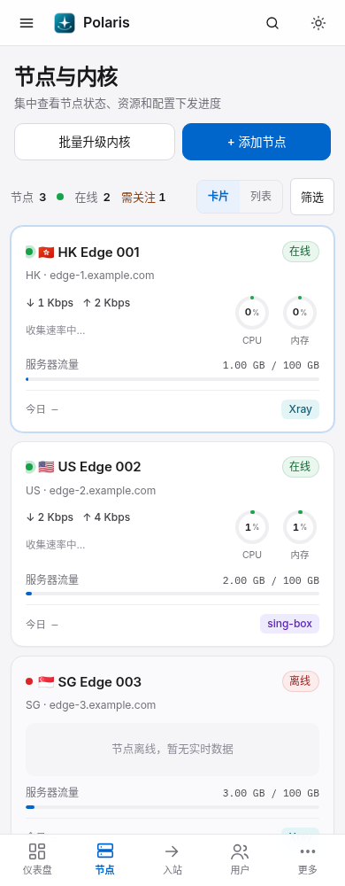
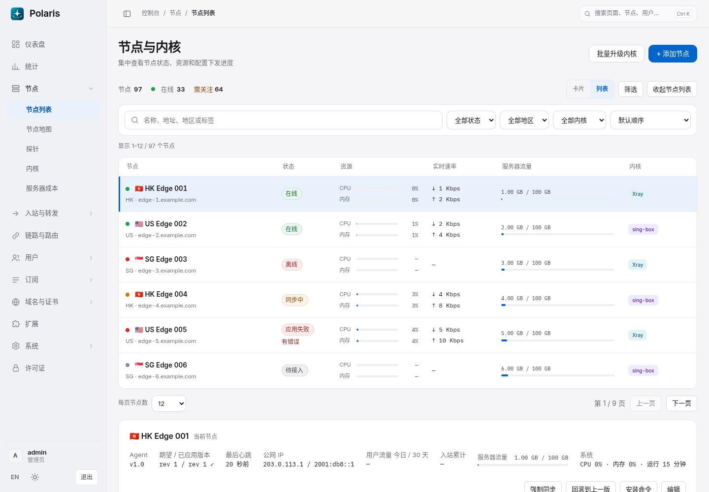
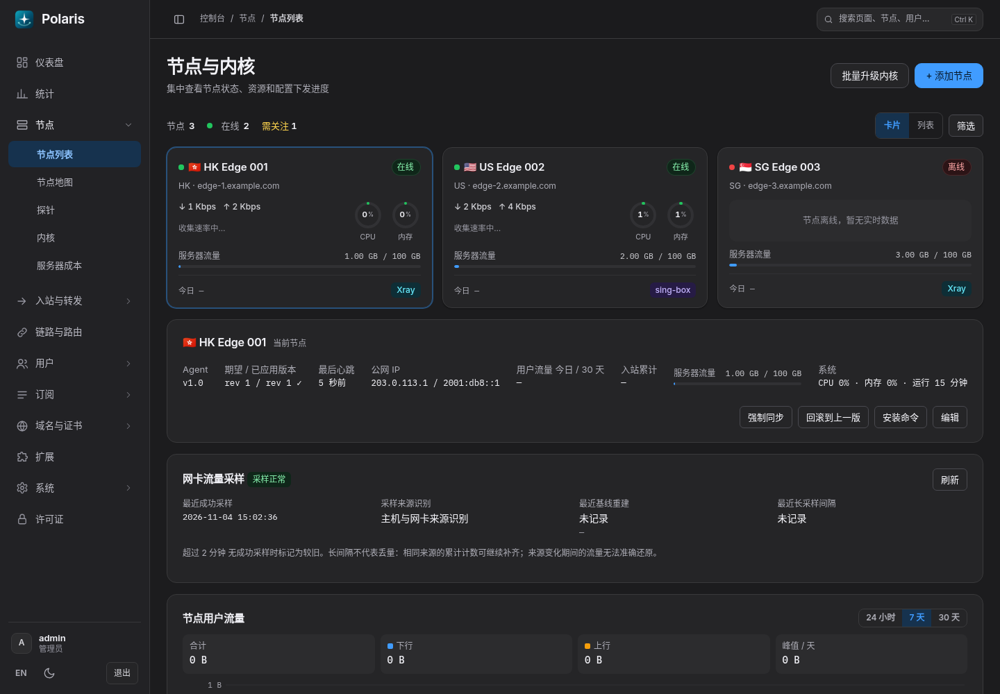
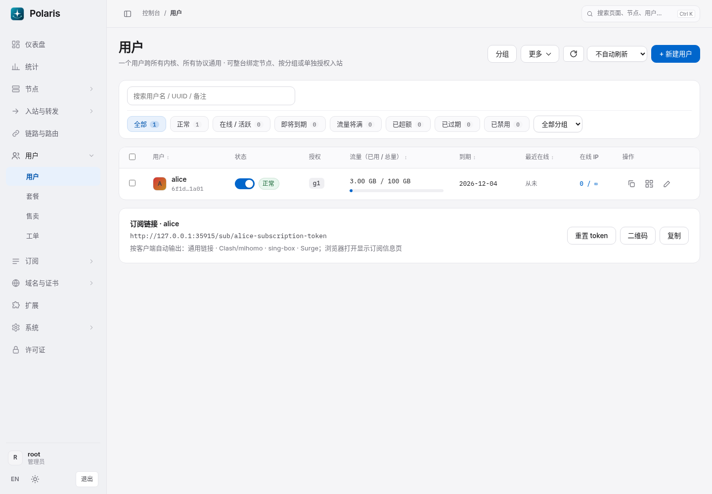

# 控制台布局与主题

导航组织沿用现有 Polaris 分区，视觉按 Apple 设计语言调整：中性表面、系统字体、简洁选中态与明确的信息层级。设计参考 [Apple Human Interface Guidelines](https://developer.apple.com/design/human-interface-guidelines/)。

## 字体、色彩与控件

- 字体优先使用 Apple 设备的系统字体，其他平台回退到项目已有的 Inter 和本地中文字体；代码与流量数字保留等宽字体。
- 默认浅色采用中性灰白，默认深色采用石墨灰。海蓝色改为系统蓝方向的配色，主要按钮与正文保持可读对比度；状态仍用绿、橙、红区分。
- 页面主标题通过字号、字重和留白建立层级，移除标题卡片外框和强调色竖线。内容卡片使用 14px 圆角，常规控件使用 10px 圆角，减少多层边框与阴影。
- 顶栏使用轻微的背景模糊，保留面包屑和全局搜索。桌面折叠按钮使用普通图标按钮，触屏设备提供 44px 点击区域。

## 导航和交互

- 桌面侧栏宽 216px，可折叠为图标栏。Logo 与账号区固定，菜单单独滚动；手机保留抽屉和底部导航。
- 子菜单通过文字缩进区分层级，移除重复图标和树形竖线。当前项仅保留底色与文字强调，取消边框和装饰竖线。
- 用户页的批量创建保留在「更多」。列表筛选工具区、审计表窄屏横向滚动、弹窗与抽屉的滚动规则继续生效。
- 下拉菜单支持点击外部、Esc 关闭与焦点返回，空间不足时调整位置并滚动。侧栏折叠、快速搜索和主题切换保留键盘操作。

## 节点页的展示逻辑

- 未保存展示偏好时，1–6 个节点默认卡片，超过 6 个默认列表。用户主动选择的卡片/列表视图仍优先并保存在当前浏览器。
- 少量节点默认收起搜索与高级筛选；大量节点默认展开。状态概况可直接切换「节点总数 / 在线 / 需关注」，卡片与列表切换始终可见。
- 筛选折叠后保留条件，并用数量标记提示；清除筛选同时恢复默认排序。筛选结果不会改变当前节点的管理操作目标。
- 默认每页 12 个节点，单页小规模部署隐藏分页和重复的「显示 1–N / N」提示；大规模部署保留每页数量与分页控制。
- 卡片网格按实际数量分配空间，单个或两个结果限制阅读宽度。点击节点后统一收起列表、更新 URL 并聚焦详情标题；「切换节点」保留查询，搜索隐藏时将焦点返回所选卡片。浏览器返回无节点 ID 的地址时自动恢复列表。
- 心跳排序不会自动切换当前节点。所选节点被删除时显示明确提示，并停止展示该节点的管理操作，避免操作落到其他节点。

## 外观偏好

保留当前浏览器已保存的明暗模式、主题风格和强调色选择，默认仍为浅色、基础风格和自动强调色。暖灰琥珀、午夜冰青及黑金的配色和授权规则继续生效。默认基础风格的表面与海蓝色随本版更新，可在「设置 → 外观」调整。

## 效果图

以下均为本地合成测试数据。

### 少量节点

### 大规模节点

### 深色与浅色界面

