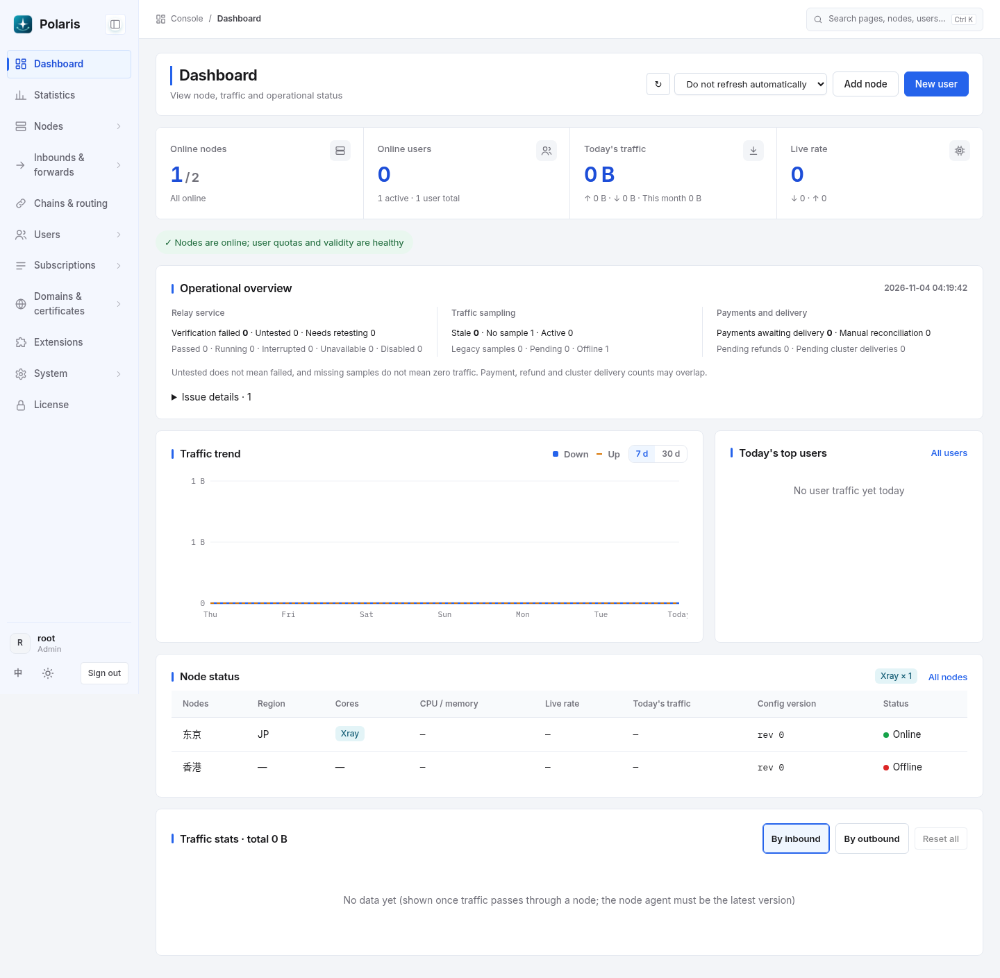
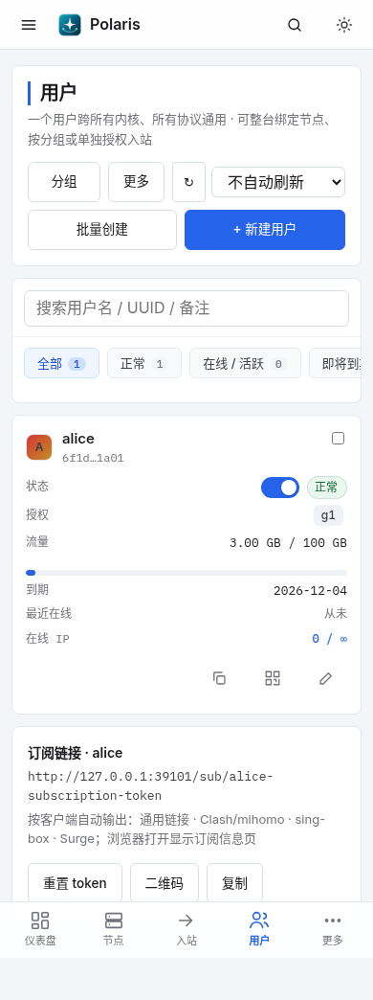
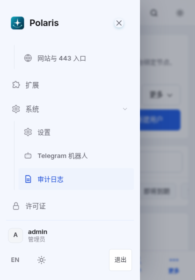
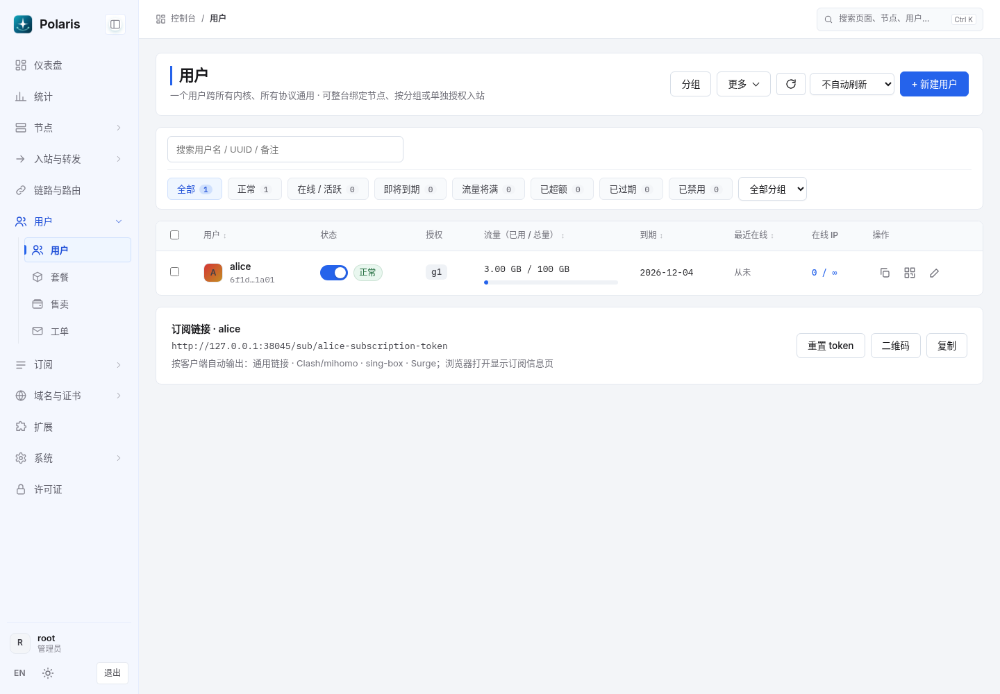
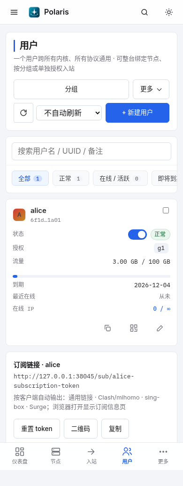

# 控制台布局与主题

本版参考 [1Panel 官方界面](https://github.com/1Panel-dev/1Panel)的信息层级和工作区布局，保留 Polaris 的品牌、菜单和业务操作。

## 布局

- 浅灰工作区承载白色卡片，缩小圆角和区块间距；标题、当前菜单及状态筛选使用统一强调色。
- 桌面侧栏宽 200px，可折叠为图标栏。菜单独立滚动，Logo、账号和退出操作固定保留在可见区域；展开多个分组也能在短屏使用。顶栏固定显示控制台、当前分区和页面层级；较窄平板将全局搜索收为图标，手机继续使用菜单抽屉和底部导航。
- 页面标题与操作、列表搜索与状态筛选各有独立区域。强调色竖线仅用于页面主标题，卡片标题通过字号与字重区分，减少重复装饰。用户、入站、订单、工单和审计列表共享筛选工具区，手机状态项可横向滑动。
- 入站批量操作栏随顶栏高度定位，避免滚动后按钮被覆盖。表格、抽屉和弹窗继续使用既有的窄屏适配和滚动规则。

## 交互细节

- 用户页保留分组、刷新和新建入口，将批量创建收进「更多」，减少页头按钮数量。
- 审计表保留可读列宽，在窄屏表格内部横向滚动，避免对象与详情逐字换行。
- 搜索、付款方式等条件排在状态筛选前。工具区换行后仍保持相同阅读顺序，空的弹性占位不再多占一行。
- 原生下拉菜单支持点击外部关闭、Esc 关闭并返回触发按钮；打开另一个菜单时收起前一个。手机页头的菜单从整组操作按钮下方展开，视口不足时限制高度滚动或向上展开，避免选项伸出屏幕。
- 下拉菜单内 Esc 优先关闭菜单，再交给弹窗；覆盖在菜单上方的弹窗仍能正常关闭。触屏菜单项至少 44px 高，保留键盘焦点提示。刷新统一使用 SVG 图标，关闭按钮悬停时不旋转。

## 配色与升级

未保存外观偏好的浏览器默认使用浅色「雾白石墨」，「跟随风格」推荐色调整为海蓝，形成蓝色控制台样式。

已有的风格、明暗模式及固定主题色继续从当前浏览器读取。暖灰琥珀、午夜冰青和黑金仍可选；默认风格的自动强调色随新推荐色更新，固定选择的石墨等配色不受影响。可在「设置 → 外观」切换。黑金的授权检查保持原有规则。

## 效果图

以下使用本地测试数据生成。

### 桌面仪表盘

### 桌面用户列表

### 手机用户列表

### 短屏菜单展开

菜单滚动到底部后，品牌和账号操作仍可见。图中使用本地测试账号。

### 细节调整后的用户页

