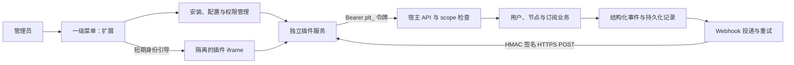

# 设计：Polaris 插件系统

状态：**外部服务插件设计，尚未实现插件管理器、Webhook 或动态插件页面**。API 令牌、基础权限范围、续期 / 加流量接口及 24 小时幂等响应缓存已经存在；不能把这部分再标为从零开发。本方案将新增工作拆成四个可单独审阅的 PR，代码和框架放在社区版公开仓库。

目标：社区开发者可以使用任意语言独立部署插件，对接支付 / 商城 / 发卡、通知、用户同步 / 单点、订阅和节点扩展。第一阶段采用“外部服务 + REST API + Webhook”，第二阶段单独设计 WASM。

菜单约定：侧边栏一级菜单 **「扩展」**，与「用户」「订阅」「系统」同级，位于「域名与证书」之后、「系统」之前。插件入口不放到「系统」子菜单。已有一级入口的开发分支为 `feat/extensions-top-level-menu`，插件页面实施时应复用该改动。

[返回项目首页](../../README.md) · [外部插件清单示例](../examples/plugins/external-notify/polaris-plugin.json)

## 1. 当前基础与交付边界

| 代码 | 已有能力 | 需要新增 / 加固 |
| --- | --- | --- |
| [`apitoken.go`](../../internal/panel/apitoken.go) | `plt_` API 令牌、哈希存储、scope 路由白名单、过期 / 吊销、基础幂等缓存 | 插件安装身份与生命周期绑定、请求内容冲突、多实例 / 崩溃下的事务幂等、OpenAPI 访问 |
| [`userops.go`](../../internal/panel/userops.go) | `POST /users/:id/renew`、`POST /users/:id/add-traffic` | 同订单事务去重与并发增量更新，避免覆盖并行订单 |
| [`notify.go`](../../internal/panel/notify.go) | 多类 `Kind` / `Text` 事件、内存 sink；Telegram 是现有接收方 | 稳定 Type / Data、用户 CRUD 事件、可靠持久化和 Webhook |
| [`server.go`](../../internal/panel/server.go) | `startJobs()`、周期任务、审计、后台任务生命周期 | Webhook 调度、健康检查、记录清理 |
| [`sub.go`](../../internal/sub/sub.go) | 订阅 Renderer 接口和编译时注册表 | 外部格式注册、授权、远程渲染和转换超时降级 |
| [`subrender.go`](../../internal/panel/subrender.go) | `serveNodes`、内置渲染及外部转换回退 | 插件调用位置、每用户隔离缓存、返回值校验 |
| [`router.go`](../../internal/panel/router.go) | 登录、节点管理员范围、sudo、自动生成 OpenAPI | 插件 / Webhook 管理 API、插件身份路由、接口 Schema |
| `GetSetting` / `SetSetting`、`store.Box` | 设置存储和敏感字段加密 | 插件独立配置模型、秘密字段不回显 |
| `App.tsx`、`portal.go` | 固定导航、后台路由、Telegram 用户中心 | 扩展动态菜单、iframe 宿主、普通用户入口 |

专业版已有高级功能继续通过宿主统一授权；社区版插件框架不隐式授予独立限速、DDNS 等高级能力。WASM、市场和 Agent 内执行不属于第一阶段。

## 2. 第一阶段架构



插件拥有自己的进程、依赖和数据库；主控只保存连接、授权、配置及投递记录，不自动安装插件程序。外部插件无法 import 宿主 `internal` 包，也不取得宿主数据库句柄、管理员 JWT、主控加密密钥或授权服务签名私钥。

接口分为四类，权限互不替代：

1. 插件调用主控：带权限范围的 API 令牌。
2. 主控调用插件：同源固定路径的 Webhook / 安装 / 健康 / 渲染请求。
3. 管理员打开插件页面：短期插件身份凭据，不能作为主控 API 令牌。
4. 用户中心打开购买 / 续费入口：普通用户身份凭据，不能冒充管理员。

## 3. 清单协议

插件在 `GET {base}/polaris-plugin.json` 返回 JSON，完整样例见[外部通知插件清单](../examples/plugins/external-notify/polaris-plugin.json)。清单只描述能力，不携带实际密码、私钥、token 或回调秘密。

| 字段 | 含义与约束 |
| --- | --- |
| `manifestVersion` | 格式主版本；未知版本拒绝 |
| `id` | 不可变插件标识，如 `epay`；小写字母、数字、点和连字符，3–128 字符 |
| `name`、`author`、`homepage` | 展示信息；自述 author 不等于已验证发布者 |
| `version` | 严格 SemVer；同 ID + 版本对应固定清单摘要 |
| `requires.hostApi` | 宿主插件协议版本范围；避免依赖尚未确定的产品版本号 `minPanel` |
| `runtime` | 一期只接受 `external`；不执行未知运行时 |
| `scopes` | 申请的 API 范围和扩展能力，管理员批准后才生效 |
| `events` | 订阅的结构化事件类型，必须被 `events` 能力覆盖 |
| `pages` | 后台页面，包含唯一 ID、标题、白名单图标和固定 path |
| `portal` | 普通用户入口，例如购买 / 续费；与后台页面分别授权 |
| `settings` | 配置字段：key、label、type、required；secret 字段加密保存且不回显 |
| `subscription` | 自定义格式列表和是否申请节点改写，包含用户代理凭据的访问须单独批准 |

清单最大 256 KiB，拒绝重复 JSON 键、未知字段、过深嵌套和重复页面 / 配置 key。字符串和列表均有限长。字段类型一期仅支持 `string`、`number`、`boolean`、`secret`，不允许 HTML、JS 或任意执行表达式。

`base` 不由清单覆盖；管理员输入后规范化并保存，禁止 userinfo、fragment 和查询参数。所有 path 必须保持在批准的 BaseURL 路径前缀中，不接受 `//other-host`、`..`、编码路径穿越或清单中另一个 origin。路径相对规则在文档和 SDK 中固定，不使用字符串拼接处理 URL。

以 `base=https://plugins.example.com/epay/` 为例，清单 path `/admin/orders` 表示 BaseURL 下的 `admin/orders`，最终地址为 `https://plugins.example.com/epay/admin/orders`；它不是要求跳到该主机根目录。

## 4. 权限与身份

### API 范围

当前已支持 `users:read`、`users:write`、`nodes:read`、`traffic:read` 和 `settings:read`。PR 1 按真实使用补齐 `subs:read` 的路由 / 数据边界；PR 4 为外部监控新增单独的 `nodes:metrics:write`，不把指标写入权限扩大成任意节点配置修改。

插件相关能力如 `events`、`pages`、`portal`、`subscription:render`、`subscription:transform` 独立记录，不能只持有某个普通 API scope 就取得它们。清单、管理员批准、宿主支持三者取交集，未登记路由默认拒绝。

令牌绑定不可变 token ID 和插件安装 ID，审计展示 `plugin:<id>`；插件 ID / 名称不是幂等身份主键。每次请求检查过期、吊销、插件状态、scope 和资源范围。插件不能调用管理员、令牌管理、安装管理或任意设置写接口。

MVP 可先将管理能力限制为超级管理员操作；若尚未提供用户 / 节点级资源隔离，安装时必须明确展示所申请 scope 的实际全局访问范围，不宣称具备尚未实现的租户隔离。写入、导出及批量接口同样检查权限，不能只过滤列表。

### 管理员与用户页面身份

使用插件独立密钥签名的 5 分钟凭据，声明包括 `iss`、`aud`、`sub`、`role`、`install_id`、`jti`、`iat`、`exp`。`aud` 只面向当前安装实例；用户身份不包含订阅令牌、UUID、密码或管理员信息。

该凭据只能用于插件自己的登录引导，**不能直接调用主控 API**。插件后端根据角色限制页面操作。优先采用一次性引导码，经 POST 交换会话；若兼容 `?polaris_token=`，必须是一次性短期身份令牌，并设置 `Referrer-Policy: no-referrer`、`Cache-Control: no-store`，插件完成验证后立即清理地址栏。

主控页面打开插件页面前验证当前管理员 / 用户会话、页面归属和插件启用状态；API token 不能生成管理员页面凭据。退出 / 卸载 / 权限变化会使新引导请求失败，已经被外部插件建立的会话需由外部服务按约定失效，不能声称宿主可强制收回全部外部会话。

## 5. PR 1：API 令牌与业务幂等补齐

基础代码已合入主分支，本 PR 是增量补齐与回归，不重复新增 `APIToken` 表和已有续费接口。

- 保留当前 `plt_` 随机令牌格式和 SHA-256 哈希存储，明文只显示一次。
- 新建、吊销需要管理员和 sudo；插件自动发放令牌使用安装 ID 绑定。
- 路由 scope 默认拒绝；提供令牌可访问的 OpenAPI 视图，并按授权过滤可见操作。
- 令牌权限选择、最近使用、有效期、吊销复用现有卡片，统一入口为一级「扩展」。
- 文档明确 `users:read` 中哪些现有接口可读取代理链接 / 凭据，通知插件默认不申请该范围。

### 支付订单幂等

已有 `Idempotency-Key` 中间件提供 24 小时响应缓存，但当前实现依赖进程锁、展示身份且在业务提交之后存响应，不能直接承诺多实例或崩溃下的恰好一次。

在支付插件上线前补齐：

1. 以不可变调用者 ID、HTTP 方法、规范化路由 / 资源和幂等键命名空间建立数据库唯一约束。
2. 保存请求摘要，同 key 不同正文返回 409，不复用其他请求的结果。
3. 对续费 / 加流量操作，把去重记录、增量业务变更和成功结果放在同一个数据库事务中。
4. 并发通过数据库锁 / 条件更新保证一致；不读取旧额度后无条件覆盖并行订单。
5. 24 小时缓存过期后，同 key 可能重新执行。商店必须保存长期订单账本；正式订单去重保留期与退款和重试周期一致。
6. 对“处理中”返回可查询状态；外部服务收到网络超时不能断言订单未执行。

保留 `POST /users/:id/renew {days, resetTraffic}` 和 `POST /users/:id/add-traffic {gb}`。无限期 / 无限流量账号的原有语义不变；退款作为独立权益调整，不能用重复加负数或删除插件模拟。

验收：鉴权默认拒绝、scope 不足、过期 / 吊销、同名令牌隔离、同 key 不同内容、并发订单、崩溃窗口和结果重放。

## 6. PR 2：结构化事件与独立 Webhook

### 事件合同

扩展 `Event` 的 `Type` 和结构化 `Data`，保留 `Kind`、`Text`、`NodeID`、`UserID`、`UserOnly`，保证 Telegram 原有文案和范围不变。

新增用户生命周期事件：`user.created`、`user.updated`、`user.deleted`、`user.traffic_reset`、`user.token_reset`，以及已有状态对应的 `user.expired`、`user.traffic_exceeded`、`node.offline`、`node.online`、`node.apply_failed` 等。每个事件有明确字段 Schema，不把中文 `Text` 当成稳定协议。

```json
{
  "id": "evt_example_01",
  "type": "user.expired",
  "schema_version": 1,
  "created_at": "2026-10-18T00:00:00Z",
  "data": { "user_id": "user_example", "reason": "expired" }
}
```

默认不外发订阅令牌、UUID、密码、完整用户对象、IP、日志或 NodeSpec。额外字段需要清单声明和管理员批准；删除事件只保存必要标识，避免序列化已经删除的整个对象。用户 CRUD 与批量操作均覆盖，失败 / 回滚的业务不发布成功事件。

### 持久化与投递

新增 `Webhook`、事件 outbox、`WebhookDelivery` 和 attempt 记录。Webhook 可独立存在，不要求安装插件；安装插件时可以创建关联 Webhook。

业务变更和 outbox 在同一事务提交，心跳等后台事件先持久化状态转换再发布。同一稳定转换去重。**不能仅把 Webhook 接入当前可能丢弃消息的 `s.sinks` 就宣称可靠交付**；Telegram 仍可保留原内存 sink，Webhook 走持久化发布点。

投递语义为至少一次：事件 ID 与 delivery ID 在重试中不变，接收方按事件 ID 去重。新增 header：

```text
X-Polaris-Signature: t=<Unix seconds>,v1=<hex HMAC-SHA256(secret, timestamp + "." + raw-body)>
X-Polaris-Event: user.expired
X-Polaris-Delivery: <delivery-id>
```

接收方用原始字节验签，常量时间比较，允许 5 分钟时钟偏差，再做去重。重试重新生成时间戳与签名；签名密钥按 Webhook 独立生成并加密存储。

默认请求总超时 5 秒，响应最多读取 16 KiB，payload 最大 256 KiB。2xx 成功；网络错误、408、429、5xx 重试；其他状态终止等待人工处理，不自动跟随重定向。`Retry-After` 有界处理。

首次立即投递，之后按 1 分钟、5 分钟、30 分钟、2 小时、12 小时退避，共最多 6 次。`startJobs` 每 30 秒扫描到期任务。每目标并发默认 1、全局默认 8；使用数据库租约和 attempt fencing，不能让过期 worker 覆盖新投递结果。

投递记录默认保留 7 天，清理只移除已终态且过保留期记录。禁用 Webhook 不调度新任务，未发送任务取消；已经在途的请求不能保证撤回。修改目标、密钥或权限递增 generation，旧任务不自动发往新配置。

### 管理入口

在一级「扩展」下提供 Webhook 管理：创建、事件选择、启停、测试、投递记录、人工重放。测试使用合成事件，不夹带真实用户凭据。重放重新检查当前权限、状态和目的地，并审计操作人。

通用事件 JSON 并不等于 Discord / 企业微信 / 钉钉 / 飞书消息格式。直连这些渠道需要目标适配器，或外部通知插件将结构化事件转换为目标消息；不把“HTTP 2xx”当作渠道内容正确的充分证据。

验收：原始正文签名、时间窗、重试时间表、去重、事务回滚、多 worker、禁用和重放、CRUD / 批量事件、Telegram 回归。

## 7. PR 3：插件安装、配置、健康和页面

### 模型

`Plugin` 保存安装 ID、清单 ID、名称、版本、BaseURL、Manifest、非敏感设置、加密秘密、批准 scopes / events / pages / portal / subscription 能力、状态、generation、LastSeenAt 和脱敏 LastError。

`PluginID` 用于展示和清单识别，安装 ID 用于数据库关联和权限隔离。同一清单 ID 在同一面板默认只安装一次；将来若允许多实例，必须保持独立配置、密钥和令牌。

### 安装与首次配对

1. 管理员输入 BaseURL，sudo 后拉取清单，检查格式、兼容性、路径、申请权限和网络目标。
2. 预览权限与实际数据范围，管理员确认配置后，先创建 disabled 的安装记录。
3. 主控生成一次性配对 nonce、插件 API 令牌和 Webhook 密钥，暂不向其开放新投递。
4. 经批准的 HTTPS 连接向 `{base}/polaris/install` 发送 `panel_url`、`api_base`、安装 ID、nonce、token 和 Webhook 密钥。
5. 插件返回安装确认和 nonce；主控校验成功后才启用安装、API 令牌与 Webhook。
6. 不支持自动安装时，安全页面只显示一次待配置凭据，管理员手动配置后测试并确认启用。

**首次请求之前没有共享密钥，仅对携带的新密钥做 HMAC 不能证明主控身份。** 首次配对依靠管理员确认目标和 TLS，外部插件也必须拒绝匿名覆盖已有配对；支持安装码 / 管理端预批准时可增加双向确认。后续控制请求才使用已配对密钥做 HMAC。

握手失败保留未启用状态并吊销新令牌，不自动重试发送无限新凭据；重复请求使用同一个安装事务 ID 幂等处理。清单没有声明的 endpoint 不调用，不把安装失败包装成“已安装在线”。

### 配置和健康

配置表单按 `settings` 渲染，secret 字段写入加密、读取只返回已设置标志；缺省保留旧值，显式清除单独表达。插件只可经自己的令牌读取 `GET /plugin/config`，宿主根据 token 对应安装 ID 决定返回对象，不接受客户端指定另一个插件 ID。

配置保存后发送可靠的 `plugin.config_updated` 事件，秘密配置不进入普通日志 / 投递展示；插件通过受限配置接口获取自己获批的必要值。该权限是明确的秘密访问能力，不能把它授予普通通知接收方。

定时请求 `{base}/polaris/health`，超时 5 秒，记录最近成功、失败分类与延迟。失联状态只影响该插件，不停止代理节点，也不自动将其权限升级或回滚配置。

### 后台菜单与 iframe

一级「扩展」包含管理首页、API 令牌、Webhook 和已启用插件声明的后台页面。宿主路由为 `/extensions/plugins/:installId/:pageId`，页面参数使用注册表解析，不接受任意外部 URL。扩展入口同时进入移动端完整菜单和快捷搜索，节点管理员不显示管理入口。

Iframe 仅加载已批准 origin 和路径，使用短期身份引导，设置 `referrerPolicy="no-referrer"` 和受限 sandbox。默认仅开放 `allow-scripts allow-forms allow-same-origin`，确有第三方登录需要时单独批准 popups；不开放 top-navigation。插件必须部署在与主控不同的 origin，避免同源 iframe 在允许脚本和 same-origin 时逃出隔离。

插件自己的 `frame-ancestors` 应允许指定面板 origin；主控针对插件容器页设置明确 `frame-src`。`postMessage` 验证 event.origin、event.source、消息类型和 schema，不能接受“任意消息即调用主控 API”的桥接。

### 用户中心入口

在 `/u` 中显示启用且批准的 `portal` 入口，如购买 / 续费。已登录用户通过专用的用户身份引导跳转，插件根据 `sub` 关联自己的订单用户。未登录、解绑或重置订阅导致用户会话失效时，不签发入口凭据。

不把用户中心身份当成付款凭证；插件仍需验证支付平台签名、金额、币种、商户和订单状态，再调用获批的主控业务接口。

### 停用、升级与卸载

停用在事务中改变插件状态、递增 generation、撤销插件令牌并取消未发送投递。启用可以重新签发令牌；不能恢复已经撤销的旧凭据。

升级重新拉取并核对清单摘要、新权限和配置兼容性；新增 scopes / 页面 / portal / subscription 能力须重新批准。卸载撤销令牌并删除关联 Webhook，保留必要审计和投递历史，不删除用户、订单或用户流量。

## 8. 内网插件与网络规则

允许管理员安装部署在同机、内网及 `127.0.0.1` 的插件，这是本项目的实际部署需求。批准对象必须是每个安装实例的规范化 origin / 路径前缀，不以一个全局“允许私网”开关开放所有目标。

- 公开地址要求 HTTPS，TLS 校验保持开启；回环 / 私网 HTTP 需管理员显式批准，并提示凭据会经该连接传输。
- 仅 localhost HTTP 可依靠主机边界；跨机器的内网连接仍建议 HTTPS，不自动忽略证书错误。
- 主控所有清单、安装、健康、iframe、Webhook、渲染、改写请求都遵循同一目标约束；不同服务的 origin 需要重新批准。
- 禁止 URL 内嵌凭据、重定向到其他目的地和通过清单替换 BaseURL；控制 DNS 重绑定与 IPv4 / IPv6 地址变体。
- 云元数据、链路本地、未指定和多播地址默认拒绝，不能因允许 localhost 而一并放开。
- 使用环境现有代理 / egress 路径时保持平台规则；无法确认实际目标时失败，不绕过代理。
- 请求体 / 响应体、解析深度、并发、频率和日志大小均设上限；无任意 shell、文件读取或上传执行能力。

## 9. PR 4：订阅、指标、OpenAPI 与开发示例

### 远程订阅渲染

安装清单声明 `subscription.formats`，宿主验证名称未与内置格式或其他插件冲突后，建立运行时路由映射。不能覆盖 `links`、`html`、`clash` 等内置格式；停用 / 卸载后移除外部映射，其他格式继续可用。

用户明确请求该外部格式时，宿主按授权后的 snapshot 向 `{base}/polaris/render` 发送节点及必要用户用量信息。请求总超时 3 秒，输出体积上限 4 MiB，MIME 必须是批准的文本配置格式，禁止用 HTML / 脚本响应占据订阅站点 origin。

缓存 60 秒，key 至少包含用户 ID、授权 / 令牌代次、配置修订、节点数据摘要、插件安装 ID、generation、格式和请求选项。账号禁用、到期、撤销授权、令牌重置后在缓存命中前重新校验，不能继续发送旧的可用订阅。

插件不可用时返回 503，不退回一个语义不同的格式。用户代理 UUID / 密码是渲染所需敏感数据，安装授权页必须明确说明；普通 `events` 或 `users:read` 权限不自动授予远程渲染。

### 订阅改写

声明 `subscription.transform: true` 的插件在 `serveNodes` 渲染前执行有序改写，单插件超时 2 秒，总链路预算有限。失败、超时或返回校验不通过时使用原节点列表。

一期允许筛选、改名和排序，不允许返回未授权的新节点、改写 UUID / 密码、扩大用户授权或悄悄改变服务器。每次转换后按原有节点身份和字段允许集校验；出现空列表应区分插件合法过滤和协议错误。链路顺序由管理员固定，避免安装顺序隐式改变用户配置。

### 外部节点监控

新增 `POST /nodes/:id/metrics`，需要 `nodes:metrics:write`。只写带来源标签的自定义测速 / 延迟指标，校验节点存在、资源范围、时间戳、数值有限性、数量和单位；不能覆盖 Agent 的可信心跳、CPU / 内存和计费流量，也不能将离线节点伪造为在线。

### OpenAPI 与 SDK

为允许插件调用的路由补请求 / 响应 JSON Schema，提供按令牌 scope 过滤的 `GET {APIBase}/openapi.json`。令牌无法通过文档接口列出管理员专属操作或秘密配置。规范使用稳定 operation ID，并在 SDK / CI 中检测不兼容变更。

开发文档放在 `docs/plugins/`：入门、清单、安装配对、scope、事件数据、原始字节签名、iframe / 用户入口、订阅扩展及兼容版本。

示例放在 `examples/plugins/`：

| 示例 | 语言 | 演示 |
| --- | --- | --- |
| `webhook-discord` | Node.js | HMAC 验签、事件去重、结构化数据转 Discord 消息 |
| `epay` | Go | 沙箱订单验签、金额 / 状态验证、订单账本、幂等续期和普通用户购买入口 |
| `sub-format` | Python | 自定义格式渲染、超时与 MIME / 缓存隔离 |

示例默认不使用真实商户密钥或生产支付，提供 `.env.example` 和测试回调数据。不能把未实现的示例目录或安装命令当成已交付功能。

## 10. 接口与数据模型落点

所有管理接口位于 `<后台路径>/api/v1`，需要管理员会话；创建 / 修改 / 启停 / 卸载 / 重放需要 sudo，普通 API token 默认拒绝。

| 逻辑 API | 用途 |
| --- | --- |
| `/tokens`、`/tokens/self` | 已有令牌管理与自身权限；插件身份绑定由安装流程控制 |
| `/webhooks`、`/webhooks/:id/test` | 独立 Webhook 管理与合成测试 |
| `/webhooks/:id/deliveries`、`/webhooks/:id/deliveries/:deliveryId/replay` | 投递记录与重放 |
| `/plugins/preview`、`/plugins` | 拉取清单预览、确认安装与列表 |
| `/plugins/:installId/config`、`/enable`、`/disable`、`/upgrade` | 配置与生命周期，使用 generation 条件写入 |
| `/plugins/:installId/pages/:pageId/launch` | 生成当前管理员的页面引导凭据 |
| `/plugin/config` | 插件专属令牌获取自身配置；不接受别的 install ID |
| `/nodes/:id/metrics` | 受限的外部自定义指标写入 |

后端建议新增 `internal/plugin`（协议、解析、版本、目标规则）与 `internal/panel/api_plugins.go`、`webhooks.go` 等宿主适配；不要把整个 `panel.Server` 暴露给外部插件。

数据模型至少包括 Plugin、Webhook、Outbox、WebhookDelivery、WebhookAttempt、业务命令去重记录。迁移由宿主管理，SQLite 和 PostgreSQL 都需通过测试。插件不得提供任意 SQL 迁移。

业务配置备份包含插件元数据和加密秘密；恢复时插件默认暂停，管理员确认外部连接和密钥后启用。待发送投递不能因恢复备份自动重复结算或跨实例转发。日志、审计和投递展示默认脱敏。

## 11. 第二阶段：WASM 和市场

单独评审纯 Go 的 wazero 运行时，不要求 CGO。与外部插件共用 scope、事件和配置概念，但必须增加内存、执行时间 / 中断、输出大小、实例隔离和最小 host functions。

WASM 默认没有文件系统、环境变量、socket 或进程执行权限。订阅改写 / 渲染等低延迟同步钩子可作为首批候选，不直接加载任意原生 Go 动态库。

插件市场使用签名索引与签名制品、固定发布者信任、内容摘要和版本兼容检查。外部服务条目先提供部署说明，WASM 只有在运行时和制品验证完成后才允许下载执行。“来自 GitHub”或清单作者字符串不等于可信签名。

## 12. 四个 PR 的合并顺序与验证

所有改动先进入开发分支，不直接推送 `main`。PR 2 基于 PR 1，PR 3 基于 PR 2，PR 4 基于 PR 3；采用堆叠 PR 时，在说明中标清依赖，前一个合并后更新后续 base。扩展导航分支单独复用，网站图标 PR 不混入插件 PR。

每个 PR 必须验证社区版和专业版：`go vet ./...`、`go test ./internal/...`、`go vet -tags pro ./...`、`go test -tags pro ./internal/...`；前端执行 `npm run i18n:check` 和 `npm run build`（含 TypeScript 检查）。专业版测试需要同版本私有代码链接，缺少依赖时不能描述为已验证。

| PR | 专项验收 |
| --- | --- |
| 1 | 令牌 scope、默认拒绝、过期 / 吊销、OpenAPI 过滤、订单幂等和多实例并发 |
| 2 | 签名、重试退避、测试 / 重放、用户 CRUD 和批量事件、事务与崩溃恢复、Telegram 回归 |
| 3 | 运行本地通知示例，验证清单预览、配对、配置、健康、一级菜单、页面身份 / iframe、卸载令牌失效 |
| 4 | 运行格式示例，验证新格式、停机 503、其他格式不受影响、改写超时回退、缓存隔离和指标不能伪造 Agent 状态 |

安全回归还需覆盖内网逐目标许可、重定向 / DNS 重绑定、跨插件配置读取、跨用户引导凭据、跨源消息、敏感字段泄露，以及权限升级须重新批准。真实服务启动、HTTP 行为和页面截图用于补充单元测试，不以“端口已打开”替代功能验证。

本文和清单是设计交付。只有对应 PR 的功能及验收完成后，README 才能宣传“已支持插件安装 / Webhook / 远程订阅格式”；目前已有的 API 集成与设计中的扩展能力应明确区分。
