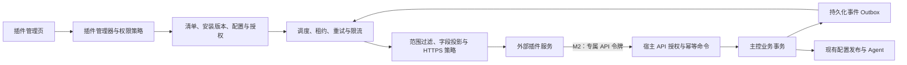

# 设计：Polaris 插件系统

状态：**设计提案，尚未实现插件管理器或运行时**。本文基于当前主控 / Agent 架构、已有 API 令牌和原子用户操作接口，定义插件的边界、契约及分阶段实施方式。本文中的 `/plugins` 接口、插件表和事件协议均为拟新增内容。

目标：让通知集成、发卡网 / 商店、DNS 服务商和订阅处理器能够独立演进，同时保持节点配置、权限判断、用户结算和专业版授权由 Polaris 主控控制。

[返回项目首页](../../README.md) · [示例插件清单](../examples/plugins/notify-webhook/plugin.json)

## 1. 核心决策

| 项目 | 决策 |
| --- | --- |
| 首个可交付插件 | Webhook 通知，通过主控内置 HTTP 投递器发送结构化事件 |
| 进程模型 | MVP 不加载第三方代码；外部业务服务独立部署，通过 HTTPS / API 集成 |
| 动态代码 | 后续评估 WASM；不采用 Go `plugin.Open`，不自动执行上传的 shell 或二进制 |
| 插件归属 | 先扩展主控，Agent 和现有 NodeSpec 不增加动态插件执行能力 |
| 权限 | 清单声明、管理员批准、宿主执行三者取交集；默认拒绝 |
| UI | 主控根据配置 Schema 渲染表单，不把第三方 JS 注入管理后台 |
| 事件 | 持久化 outbox，至少一次投递；接收方幂等，不承诺恰好一次 |
| 商业能力 | 使用现有许可证机制独立判断；插件安装成功不等于获得专业版授权 |
| 发布与卸载 | 不要求主控重启；版本与配置留痕，禁用立即停止新调度和 API 授权 |

第一阶段做“可管理、可撤销、可观测的外部集成”，后续再逐项扩大能力。主控不把数据库句柄、会话令牌、签名私钥或整个 NodeSpec 交给插件。

## 2. 现有代码与需要补齐的部分

| 当前基础 | 可复用部分 | 当前边界 |
| --- | --- | --- |
| [`core.CoreAdapter`](../../internal/core/core.go) | Render、Validate、进程管理、流量、健康与版本能力 | `core.Register` 在编译时注册；不是运行时可安装插件 |
| [`notify.go`](../../internal/panel/notify.go) | 节点、用户和配置告警来源 | 内存通道满时丢弃；`Text` 是内部展示文案，不适合作为稳定外部事件 |
| [`apitoken.go`](../../internal/panel/apitoken.go) | Bearer API 令牌、scope 路由白名单、令牌过期和审计身份 | 目前 scope 较粗，`PluginID` 尚不是完整插件生命周期；令牌不提供节点 / 用户级资源隔离 |
| [`userops.go`](../../internal/panel/userops.go) | 续期与增加流量的独立接口 | 不应据此承诺多实例、崩溃重试下的订单恰好一次执行 |
| [`router.go`](../../internal/panel/router.go) | 登录、节点管理员范围、敏感操作复验和审计 | 插件管理和插件 API 授权仍需独立检查，不能只隐藏菜单 |
| [`ddns.go`](../../internal/panel/ddns.go) | DNS 服务商配置、密钥加密和 Cloudflare / Webhook 入口 | 类型枚举和调用路径需要分阶段抽象 |
| `*_oss.go` / `*_pro.go` | 社区版与专业版编译边界 | 现有高级功能并非插件；MVP 不搬迁闭源代码 |

主控已有 API 令牌可以供外部程序使用，但“能调用 API”与“可安装插件系统”是两个层次。先保留现有兼容接口，新增管理层时再为插件令牌绑定明确身份、资源范围及撤销规则。

## 3. 插件类型与实施顺序

| 扩展点 | 用途 | 阶段 | 宿主边界 |
| --- | --- | --- | --- |
| `notification.sink` | 企业微信、钉钉、自建通知中心等 Webhook 集成 | M1 | 只接收批准的事件字段，不读取用户凭据 |
| `business.connector` | 商店、发卡网、支付到账后的续期和加流量 | M2 | 仅经细分 API 和幂等操作，不直接修改数据表 |
| `dns.provider` | 新 DNS 服务商和记录管理 | M3 | 宿主限定已绑定域名及记录，外部服务接收最少必要凭据 |
| `subscription.transform` | 节点筛选、名称映射、格式后处理 | M3 | 对有界的去敏快照执行，不进入在线请求的无限重试链 |
| `core.adapter` | 新代理内核 | 单独评审 | 需协议、能力、UI、订阅、Agent 和制品信任共同支持 |

第一阶段不接入支付回调、不下发用户凭据、不允许第三方修改路由 / 防火墙，也不把所有现有高级功能一次性改成插件。

## 4. 总体架构



逻辑模块：

- `internal/plugin`：清单解析、版本兼容、权限归一化、生命周期和事件契约，不依赖 Gin。
- `internal/plugin/webhook`：宿主内置的 HTTPS 投递器；不是任意代码执行器。
- `internal/store`：插件记录、配置、密钥引用、outbox 和投递记录的持久化。
- `internal/panel/api_plugins.go`：API 到管理器的适配；负责现有登录、复验和审计接入。
- `web/src/pages/Plugins.tsx`：列表、配置、权限、诊断和投递记录。
- 后续 `pkg/pluginapi/v1`：可公开依赖的协议类型；外部插件不能 import 本项目的 `internal` 包。

管理器通过窄接口调用业务服务，禁止插件管理器反向依赖整个 `panel.Server`。MVP 可以使用宿主内部接口；发布 SDK 时再建立稳定的独立模块版本。

## 5. 清单与配置契约

完整样例见 [`plugin.json`](../examples/plugins/notify-webhook/plugin.json)。清单是插件能力声明，**不包含 endpoint 实际值、token、密码或私钥**。

关键字段：

| 字段 | 约束 |
| --- | --- |
| `manifestVersion` | 清单格式主版本，MVP 为 1；未知版本拒绝安装 |
| `id` | 小写反向域名标识，长度 3–128，只允许小写字母、数字、点与连字符；安装后不可变 |
| `version` | 严格 SemVer；同一 ID + 版本只能对应同一内容摘要 |
| `runtime` | MVP 只接受 `host-webhook-v1`，未知运行时拒绝 |
| `requires.hostApi` | 需要的宿主插件 API 范围；不把 `dev` 或未知构建当作自动兼容 |
| `extensionPoints` | 明确声明使用的扩展点，未声明能力不可调用 |
| `permissions` | 事件、可见字段、API scope 和网络策略；清单声明不是实际授权 |
| `configSchema` | JSON Schema 2020-12 的受限子集；本地校验并渲染表单 |

Schema 只允许对象、数组、基础类型、枚举、长度、数值界限及本地定义引用；禁止远程 `$ref`、可执行默认值、HTML / JS 控件及任意模板表达式。清单最大 256 KiB，拒绝重复 JSON 键、未知顶层字段、循环引用和过深嵌套。

`writeOnly` 字段在写入时加密，配置查询只返回 `configured: true`，不返回原值。更新时“未提供”保留原值，显式清除使用独立字段 / 操作，避免空字符串意外覆盖。

`endpoint` 通过 Schema 只做格式校验，运行时仍必须做 HTTPS、目标地址与网络策略校验。JSON Schema 的 `format: uri` 本身不是 SSRF 防护。

插件版本、Host API 版本、事件版本分别管理。MVP 示例的 `hostApi: ^1.0.0` 指拟发布的协议，不表示当前仓库已经支持该版本插件。

## 6. 生命周期与管理员操作

状态转换：

```text
installed → configured → enabled → disabled
                ↑           ↓
                └────── degraded
```

- `installed`：清单已验证并保存，未获得网络或 API 访问。
- `configured`：必填配置有效，管理员已保存范围及权限。
- `enabled`：权限批准完成，可调度事件；M2 插件可获取专属令牌。
- `degraded`：连续投递失败或配置不可用，熔断暂停；保留失败记录。
- `disabled`：停止调度，撤销插件 API 令牌，不删除现有业务数据。

安装流程：上传 JSON 清单 → 兼容性检查 → 展示发布者、声明能力和权限 → 填写配置 → 选择节点范围 → 测试连接 → 管理员复验后启用。

MVP 只接受管理员主动导入的 JSON 描述，不下载或执行远端代码。`publisher` 是自述信息，没有签名时展示“未验证发布者”；不能因为 ID 以 `org.polaris` 开头就显示官方认证。

配置、endpoint、授权范围、签名密钥变化时递增 `generation`。升级新增权限必须重新批准；不能自动继承更宽权限。数据模型分别保存“请求权限”和“批准权限”，运行时检查当前有效交集。

禁用必须在事务中改变安装状态、递增 generation 并撤销关联令牌。未发送任务标记取消，worker 发请求前再次验证状态和 generation。已在途的 HTTP 请求只能尽力取消，不能收回已送达的数据。重新启用默认只收取新事件，旧任务须显式审阅后重放。

卸载前处理订阅 / DNS 等依赖引用，存在依赖时返回冲突。卸载只移除插件安装与秘密配置，不自动撤销历史发卡订单或重置用户流量。投递和审计记录按保留策略保存。

## 7. 权限与身份

### 7.1 插件访问宿主

现有 `users:write` 可创建、修改、删除及重置用户，对通知和普通订单插件过宽。M1 通知插件不签发 API 令牌。M2 扩展时增加如 `users:renew`、`users:traffic:add`、`users:read:minimal` 的细分 scope，并保持现有令牌兼容。

每个安装实例绑定不可变的 install ID，令牌关联 install ID 和 token ID；不能使用可修改的名称作为身份或幂等命名空间。每次请求必须验证：

1. 令牌有效、未撤销，插件处于 enabled 且 generation 匹配。
2. 当前路由在插件 API 白名单内，scope 同时被清单请求、管理员批准和宿主支持。
3. 目标资源属于安装实例的允许范围；对列表、导出、批量操作与路径 ID 同样检查。
4. 操作满足主控的业务规则、数量上限和许可证要求。

插件不继承管理员浏览器会话。节点管理员和普通用户在 MVP 中不能安装、升级或修改插件权限。未经批准的字段 / 路由一律返回拒绝，不能通过新 API 自动扩大旧令牌的权限。

### 7.2 宿主向外部发送数据

资源范围为“全部节点”或明确节点 ID 列表，默认空范围。用户事件在 M1 暂不开放，避免用户跨多个节点产生歧义；M2 单独定义用户范围和数据授权。

MVP 字段白名单仅包含资源种类、内部 ID、有限的状态码。禁止默认发送 `Event.Text`、订阅链接、用户 UUID / 密码、公网 IP、环境变量、管理员会话、完整日志或 NodeSpec。

作用域内发生的事件还要按批准字段投影，不是过滤节点后把整个对象原样序列化。撤销范围时，重试和人工重放也使用当前授权重新检查。

## 8. 事件协议与可靠投递

MVP 只定义 `node.offline.v1`、`node.online.v1`、`node.apply_failed.v1`，后续增加事件应明确字段与隐私范围。

投递 JSON 示例：

```json
{
  "specversion": "1.0",
  "id": "evt_01K7M9A0000000000000000001",
  "type": "node.offline.v1",
  "source": "polaris://inst_example/plugins",
  "time": "2026-10-18T00:00:00Z",
  "subject": "node/node_example",
  "resource": { "kind": "node", "id": "node_example" },
  "data": { "reason_code": "heartbeat_timeout" }
}
```

采用 CloudEvents 风格的字段，不声称未验证的完整标准兼容性。`id` 在源事件首次持久化时生成，所有重试和人工重放保持相同事件 ID；投递另有 delivery ID 和 attempt。展示文案由接收服务基于状态码生成。

### Outbox 与事务

- 对已有数据库业务变更，在同一事务内写业务记录和 outbox，提交后再调度。写 outbox 失败时事务返回失败，不能宣称“业务成功且事件可靠”。
- 心跳超时等后台事件先持久化状态转换及稳定 transition ID，同一转换重复观察不生成无界重复事件。
- 不直接把 `notify()` 的有损通道桥接成“可靠队列”；其现有 Telegram 路径可以保留，M1 为新增三个事件建立明确的持久化发布点。
- 外部 HTTP 故障不阻塞业务请求，重试在 worker 中执行。无匹配订阅时不生成投递任务；业务 outbox 的保留策略独立配置。

创建投递时记录安装实例、generation 和批准配置版本。发送内容是稳定投影，重试不得悄悄加入后来新增的敏感字段；endpoint 或密钥变更后取消旧 generation 的待发送任务，由管理员决定是否重放到新配置。

### 调度与响应

| 项目 | MVP 默认值 / 规则 |
| --- | --- |
| 交付语义 | 至少一次；接收方按事件 ID + 安装 ID 去重 |
| 请求 | HTTPS POST，UTF-8 JSON，单次正文上限 64 KiB |
| 超时 | 连接 3 秒，总请求 10 秒，不跟随重定向 |
| 成功 | 任意 2xx 表示接收成功；202 仅承诺对方已接收 |
| 重试 | 网络错误、408、429、5xx；指数退避加抖动，最多 8 次 / 24 小时，先到者停止 |
| 其他 4xx / 3xx | 永久失败，进入失败队列；修复后显式重放 |
| `Retry-After` | 支持合法秒数 / 日期，等待上限 1 小时，仍受 24 小时总期限约束 |
| 并发 | 每安装实例默认 1，主控总并发默认 8；有上限的待发送队列 |
| 顺序 | 不保证全局顺序；事件包含发生时间，接收方不得仅依赖抵达次序 |
| 响应正文 | 最多读取 16 KiB 用于诊断；默认只持久化脱敏状态与错误码 |

发送后、确认落库前崩溃会产生重复，这是至少一次语义的正常情况。超限 / 过期记录标记 terminal，不静默丢弃；积压量、最老事件年龄、失败率和熔断状态必须可见。默认终态记录保留 7 天，未终态记录在 24 小时投递期限内不得被清理。

Worker 使用数据库中的 `lease_owner`、`lease_until`、attempt token 原子抢占。确认结果须带当前 attempt token 做条件更新，避免租约过期的旧 worker 覆盖新结果。SQLite 使用短事务 / 条件更新，PostgreSQL 可优化为行锁；不能只依赖进程内互斥锁。

## 9. Webhook 签名与网络策略

每次发送添加：

```text
Polaris-Event-Id: <event-id>
Polaris-Delivery-Id: <delivery-id>
Polaris-Timestamp: <Unix seconds>
Polaris-Signature: v1=<hex HMAC-SHA256>
```

签名原文为 UTF-8 字节串：`timestamp + "." + event-id + "." + delivery-id + "." + raw-body`。接收方使用原始请求正文验签、常量时间比较，允许时钟偏差 5 分钟，再按事件 ID 去重。每次重试更新 timestamp 和签名；delivery ID 保持不变。

签名密钥每个安装实例独立，至少 32 字符的高熵随机值，宿主使用现有 `store.Box` 加密后存储。管理员在外部接收服务配置同一密钥；明文只在安全配置时传递，不出现在清单、日志和投递历史。轮换时取消旧 generation 的任务；接收端可在短时间内同时接受新旧密钥。

网络策略要求：

- 默认只允许配置的 HTTPS endpoint，TLS 证书和主机名校验必须开启；禁止 endpoint 内嵌用户名 / 密码。
- 校验规范化主机名、端口及 DNS 解析结果，默认拒绝回环、私网、链路本地、云元数据和多播地址，覆盖 IPv4、IPv6 和映射地址。
- 校验后的地址必须与实际连接绑定，防止 DNS 重绑定；重试重新校验。禁止自动跟随 30x，避免跳转到未批准目的地。
- 使用环境提供的批准代理 / egress 路径时，由代理策略参与约束；无法验证目标安全性时拒绝发送，不自行绕过代理。
- 私有通知服务若确有需求，通过管理员专门批准的目的地策略开放，显示范围并审计；不能因某插件而全局关闭地址检查。
- 不提供任意请求头、任意 HTTP 方法或脚本化请求模板。插件 ID、用户输入不能拼接成文件路径、shell 或数据库语句。

MVP 宿主不执行第三方程序，因此不需要把“同用户子进程”伪装成安全沙箱。若未来支持本机外部程序，必须明确其与宿主拥有相同系统权限的风险；优先独立容器 / 服务身份。

## 10. 数据模型与升级策略

建议新增的逻辑表：

| 表 | 主要内容 |
| --- | --- |
| `plugin_packages` | plugin ID、version、清单、SHA-256、发布者验证结果；ID + version 唯一 |
| `plugin_installations` | install ID、活动包版本、state、generation、批准权限、资源范围、配置版本 |
| `plugin_config_revisions` | 每次配置的非敏感字段和加密秘密引用；不可由插件写 SQL |
| `plugin_outbox` | 稳定源事件、schema 版本、发生时间、资源、fanout 状态 |
| `plugin_deliveries` | delivery ID、event ID、install ID、generation、投影、状态、下一次发送时间、租约 |
| `plugin_delivery_attempts` | attempt ID、时间、耗时、HTTP 状态、脱敏错误码 |

`plugin_deliveries` 的 event ID + install ID + generation 唯一，fanout 和 worker 崩溃重试可重复执行而不复制任务。人工重放复用原 delivery；若显式选择新配置，则创建新 generation 对应的 delivery，事件 ID 不变。接收方仍按原事件去重，不把重放当新业务事件。

表迁移由宿主统一管理，插件不能提供数据库迁移脚本。MVP 配置升级必须通过新 Schema 验证，不能无声丢弃字段；失败保留旧版继续运行，管理员可导出脱敏差异后修正。

升级以“验证新包 → 验证迁移后的配置 → 权限复核 → 原子切换版本 / generation → 新任务调度”执行。回退使用旧包和旧配置快照，但不恢复已撤销权限，也不自动重放外部副作用。

## 11. 管理 API 与界面

以下均位于 `<后台路径>/api/v1` 下，只有管理员会话可调用；现有 API 令牌默认无权访问这些管理接口。

| 拟新增接口 | 用途 |
| --- | --- |
| `GET /plugins` | 安装列表、状态、版本和失败摘要 |
| `POST /plugins/install` | 校验并导入清单；不执行安装脚本 |
| `GET /plugins/:installId` | 清单、已批准权限、脱敏配置和 generation |
| `PUT /plugins/:installId/config` | 保存配置和范围，使用 generation 条件写入 |
| `POST /plugins/:installId/test` | 发送无真实用户信息的合成测试事件，使用相同网络限制 |
| `POST /plugins/:installId/enable` | 复核配置、兼容性、权限并启用 |
| `POST /plugins/:installId/disable` | 停止调度、撤销令牌、取消待发送任务 |
| `POST /plugins/:installId/upgrade` | 导入已验证版本并切换 |
| `DELETE /plugins/:installId` | 卸载，存在依赖时返回 409 |
| `GET /plugins/:installId/deliveries` | 投递列表，按状态分页，不返回密钥 / 全量 payload |
| `POST /plugins/:installId/deliveries/:id/replay` | 受控重放，限流、复验并记录原因 |

返回错误区分版本不兼容、缺少配置、权限未批准、许可证限制、范围冲突和不可达，不把所有错误显示成“安装失败”。并发修改返回 409，并展示需重新加载的 generation。

「系统 → 插件」中提供已安装列表与添加入口。详情页分为概览、配置、权限、投递记录；启用前显示将发送的数据、目的地和节点范围。故障显示最近成功时间、失败分类和下一次重试时间。没有服务端真实统计前，不显示假成功率或运行状态。

所有敏感配置变更、启停、升级、授权、重放与卸载通过现有 `requireSudo` 复验和审计。插件自身无权修改清单、批准权限或读取其他安装实例的信息。

## 12. 商店 / 发卡网与幂等性（M2）

外部商店先验证支付平台签名、金额、币种、订单状态与商品映射，再调用宿主的受限续期 / 加流量接口。浏览器传入“支付成功”不能直接触发授权，插件回调不能成为绕过订单验证的入口。

复用 `POST /users/:id/renew`、`POST /users/:id/add-traffic` 的业务语义，增加安装实例绑定、用户范围和细分 scope。插件不持有 SQLite 文件或任意 SQL 接口，也不通过覆盖整个用户对象修改套餐。

现有 `Idempotency-Key` 是基础能力，但在承接真实订单前必须补齐：

- 使用不可变 token ID / install ID，而非展示名称区分调用者。
- 对 key、方法、资源及规范化请求内容建立摘要；同 key 不同请求内容返回 409。
- 订单操作记录、用户变更和成功结果在同一数据库事务提交，消除“业务成功但结果未保存”的崩溃窗口。
- 用唯一索引及数据库锁 / 条件更新处理并发，不依赖 `sync.Map` 的单进程互斥。
- 自动化订单幂等保留期与退款 / 重试周期一致，不能只依赖当前 24 小时响应缓存。
- 对尚未完成的请求返回可查询的处理中状态；外部插件不得将网络超时视为必定未执行。

同一已验签支付订单重试只能产生一次权益变更。退款、争议和撤销作为独立业务命令，显式指定订单与调整规则，不使用“删除插件”模拟退款。

## 13. 专业版与未来运行时

插件机制本身可以作为社区版通用集成基础。DNS 自动绑定、订阅转换、品牌定制、独立限速等既有高级能力继续由现有功能授权控制；具体哪些连接器收费由产品规则决定，不在基础运行时写死。

清单中的功能声明不能直接授予权限。插件请求高级操作时，仍走宿主统一业务接口和许可证判断。许可证失效与用户禁用分别记录；已经应用的节点配置按现有许可策略处理，不能因为通知插件异常重启内核。

未来 WASM 运行时需要单独评审：内存上限、执行时间 / 中断、输出大小、无默认文件系统 / 环境变量 / socket、最小 host functions、实例隔离和可观测性。MVP 的 runtime allowlist 不预先开放 `wasm` 或 `exec`。

内核插件同样不是仅实现 `CoreAdapter` 就完成：还需要 CoreType 命名空间、版本能力描述、统一模型表达、订阅输出、前端表单、Agent 兼容性与签名制品下载。当前枚举 / 分支需逐项改造，未来协议不可把未知字段静默丢弃。节点侧进程及网络权限高，必须单独设计授权和版本协商。

## 14. 分阶段交付与验收

### M0：固定基础契约

- 明确 scope / 资源范围、稳定插件身份及授权边界；梳理现有 API 的敏感字段。
- 定义清单解析、Host API 版本和三种节点事件 Schema。
- 保持现有 API 令牌接口可用，标明其当前全局 scope 范围和幂等边界。

### M1：通知插件 MVP

- 完成清单导入、插件页、Schema 配置表单、启停与权限复验。
- 完成持久化 outbox、投影、租约 worker、签名 HTTPS、失败记录和受控重放。
- 以 Webhook 样例连接一个本地测试接收器，覆盖节点离线、恢复和配置失败事件。
- 不安装第三方代码，不签发通知插件的 API 写令牌，不改变 Agent 协议。

### M2：商店集成

- 完成细分 scope、用户资源范围、插件令牌撤销及事务幂等。
- 提供开发 SDK / HTTP 契约、沙箱订单示例、支付回调验签适配说明。
- 验证重复订单、超时、崩溃恢复、退款与权限撤销。

### M3：提供者与分发

- 分别抽象 DNS provider 和订阅处理器，定义超时、失败回退及高级功能授权。
- 发布者密钥、签名清单及目录机制另行实现；签名对规范化清单和内容摘要负责，不代表能力自动批准。
- 最后评估 WASM 与节点内核插件，不把它们作为 M1 的隐含依赖。

### 必须通过的验证

| 类别 | 验证重点 |
| --- | --- |
| 清单与配置 | 未知 runtime / 权限拒绝；重复 key、超大 / 过深 JSON、远程 `$ref` 拒绝；秘密不回显 |
| 权限 | 通知无写令牌；越范围 ID / 批量接口拒绝；禁用后旧令牌即时失效；重放重新校验范围 |
| 网络 | 私网 / IPv6 映射地址、DNS 重绑定、重定向、非法证书、代理不可验证路径被拒绝 |
| 可靠性 | 事务回滚无事件，提交有事件；worker 重启、租约过期、发送后崩溃产生可去重的重试 |
| 并发与存储 | SQLite 与 PostgreSQL 下的多 worker / 双主控抢占；过期 worker 不覆盖新结果 |
| 生命周期 | endpoint 变化不泄露旧任务；权限扩大重新批准；卸载不删除用户业务数据 |
| 商业操作 | 同订单并发 / 崩溃重试只加一次权益；相同 key 不同正文冲突；撤销 token 后无法查询结果 |
| 回归 | 社区版 / 专业版构建、现有 Telegram、用户订阅、配置发布和 Agent 不受插件停机影响 |

完成 M1 后才能在 README 宣称支持“可安装通知插件”；完成 M2 后再宣传商店插件正式集成。在此之前，当前功能仍是受限 API 集成，本文和示例清单用于设计评审与实施拆解。
